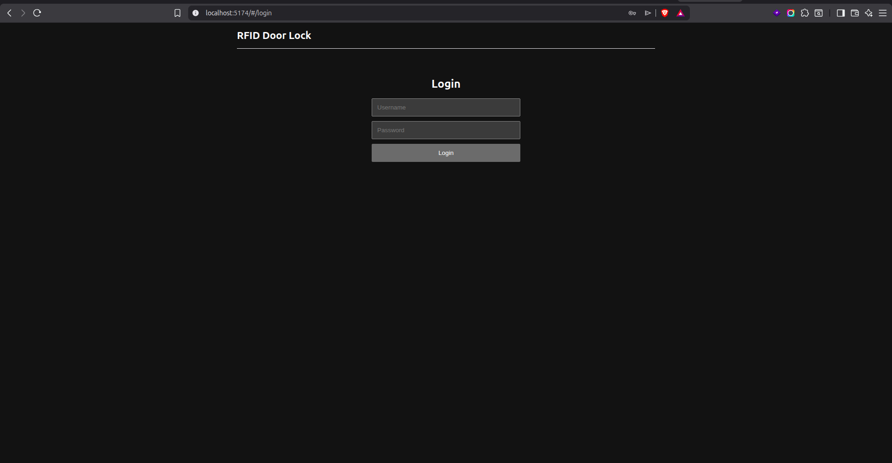
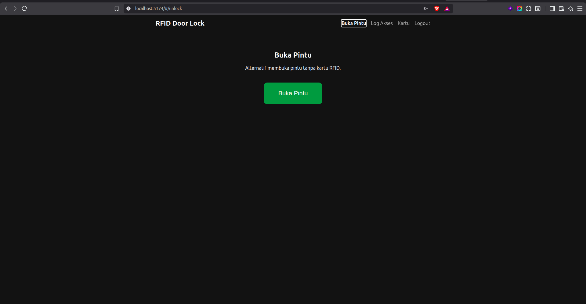
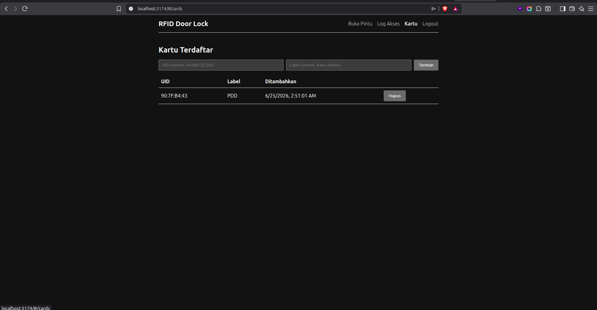
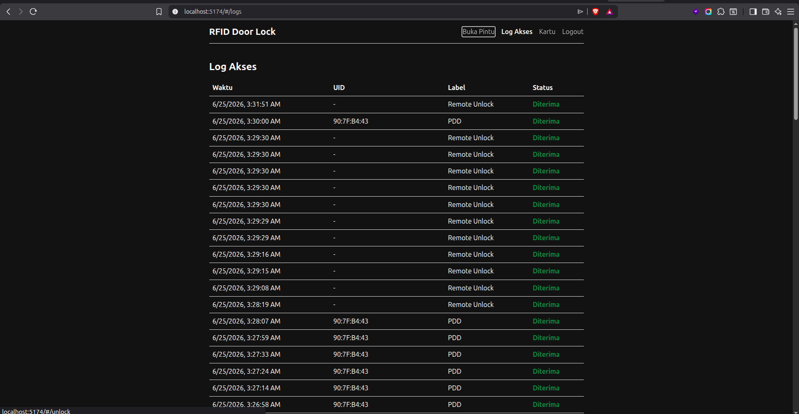

# RFID Door Lock

Sistem kunci pintu berbasis RFID memakai ESP8266 (NodeMCU Amica), dengan dashboard web untuk manajemen kartu, log akses, dan tombol buka pintu jarak jauh.

## Fitur

- Tap kartu RFID (RC522) untuk membuka kunci pintu (relay + solenoid lock)
- LCD 16x2 (I2C) menampilkan status "Tempelkan Kartu" / "Akses Diterima" / "Akses Ditolak"
- Buzzer sebagai feedback suara (beep singkat saat diterima, beep ganda saat ditolak)
- Dashboard web (login admin) untuk:
  - Mendaftarkan/menghapus kartu RFID
  - Melihat riwayat log akses (real-time, polling 5 detik)
  - Membuka pintu dari jarak jauh tanpa kartu (tombol "Buka Pintu")
- Otorisasi & pencatatan log dilakukan di backend, bukan hardcoded di firmware

## Arsitektur

```
ESP8266 (firmware) ── WiFi/HTTP ──> Backend (Go) ──> PostgreSQL
                                        ^
                                        │ REST API (JWT)
                                        │
                                  Frontend (Vue 3)
```

| Komponen | Teknologi |
|---|---|
| Firmware | PlatformIO, Arduino framework (ESP8266), MFRC522, LiquidCrystal_I2C, ArduinoJson |
| Backend | Go (`net/http` + GORM), PostgreSQL, JWT auth |
| Frontend | Vue 3 + Vite, Vue Router |
| Database | PostgreSQL 16 |
| Deployment | Docker Compose (db + backend + frontend) |

## Hardware

- ESP8266 NodeMCU (Amica / ESP-12E)
- RFID-RC522 (SPI, 13.56MHz)
- LCD 16x2 dengan modul I2C (PCF8574, alamat `0x27`)
- Relay 1-channel (SRD-05VDC-SL-C) + solenoid door lock
- Buzzer aktif

Detail pin & wiring lengkap: [`WIRING.md`](WIRING.md).

## Cara menjalankan

### Backend + Frontend + Database (Docker)

```bash
cp .env.example .env   # lalu sesuaikan ADMIN_USERNAME/PASSWORD, JWT_SECRET, BACKEND_PUBLIC_URL
docker compose up -d --build
```

- Dashboard: `http://<IP>:5174`
- API backend: `http://<IP>:8080`

`BACKEND_PUBLIC_URL` di `.env` harus IP LAN komputer (bukan `localhost`) supaya dashboard bisa dibuka dari device lain (HP, dll) dan supaya ESP8266 bisa menjangkau backend.

### Firmware (PlatformIO)

Isi kredensial WiFi dan URL backend di `include/config.h`, lalu:

```bash
pio run -t upload      # compile + upload ke NodeMCU
pio device monitor      # lihat log serial (115200 baud)
```

Detail lengkap: [`HOW-TO-RUN.md`](HOW-TO-RUN.md).

## API singkat

| Endpoint | Auth | Keterangan |
|---|---|---|
| `POST /api/v1/login` | - | Login admin, balas JWT |
| `POST /api/v1/access` | - | Dipanggil firmware tiap tap kartu |
| `GET /api/v1/unlock/poll` | - | Dipolling firmware untuk cek perintah buka pintu jarak jauh |
| `GET/POST /api/v1/cards` | JWT | Daftar / tambah kartu |
| `DELETE /api/v1/cards/{id}` | JWT | Hapus kartu |
| `GET /api/v1/logs` | JWT | Riwayat log akses |
| `POST /api/v1/unlock` | JWT | Trigger buka pintu jarak jauh |

## Screenshot

### Login



### Buka Pintu (alternatif tanpa kartu RFID)



### Kartu Terdaftar



### Log Akses


